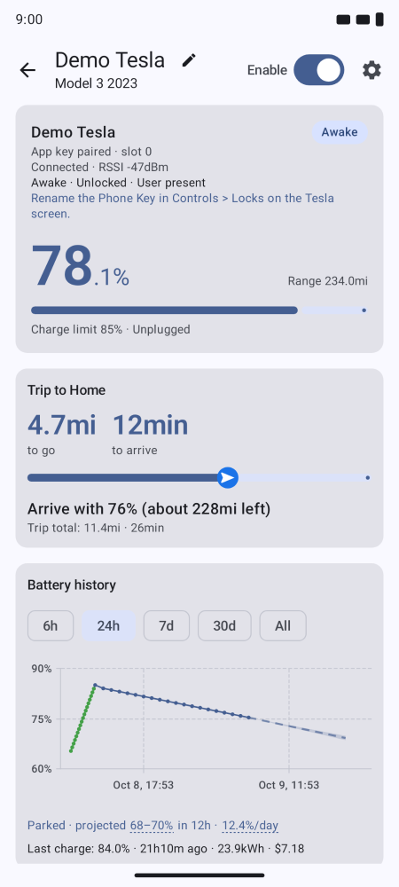
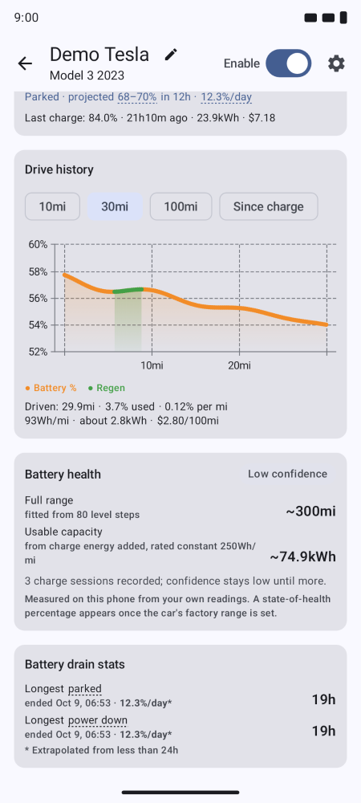
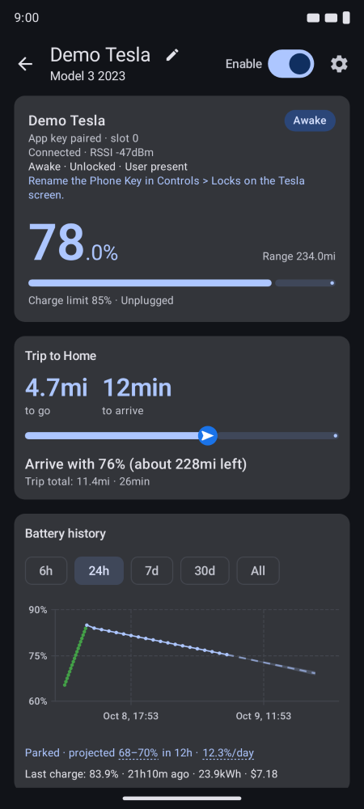
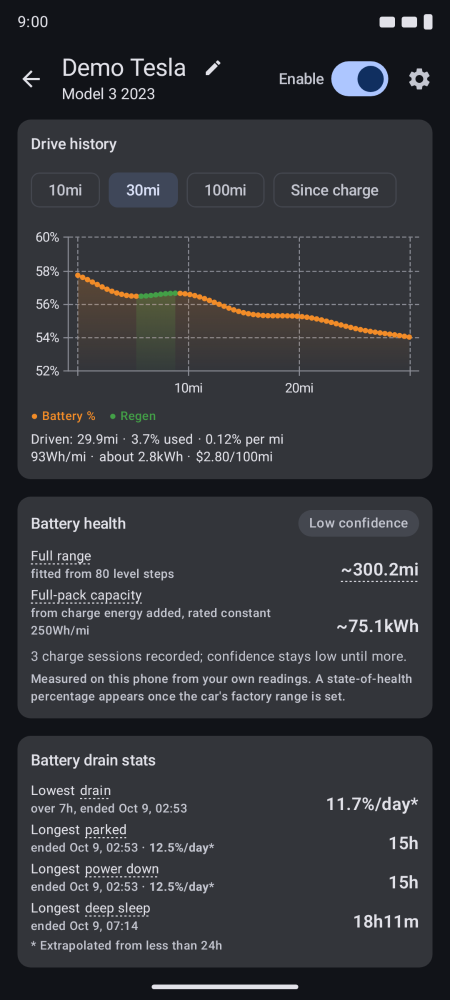

# TeslaBatteryBLE

Android app that tracks Tesla battery statistics directly over Bluetooth LE

[](https://github.com/opencartools/TeslaBatteryBLE/actions/workflows/android.yml)
[](https://opencartools.github.io/TeslaBatteryBLE/)
[](LICENSE)
-green.svg)
[](docs/master-plan.md)

TeslaBatteryBLE talks to a Tesla over Bluetooth LE using an enrolled vehicle key —
the same local protocol Tesla's [`vehicle-command`](https://github.com/teslamotors/vehicle-command)
uses. Install the
app, pair a key with an NFC card tap on the console, and read over the BLE directly.

## Screenshots

Light and dark themes, side by side.

**Light**

<p></p>

**Dark**

<p></p>

## Features

- Scan for nearby Teslas, pair a key with an NFC card tap, then read the battery and charge state over an encrypted session
- Battery history graph, drive graph, charge cost at your home price, trip card and past trips
- Background tracking that lets the car sleep; the car is woken only when you ask
- Metric or imperial units, light and dark themes
- Everything is computed on-device; the app has no internet permission

All features in detail: [`docs/features.md`](docs/features.md). What is planned: [`docs/master-plan.md`](docs/master-plan.md).

## Install

Download the APK from [Releases](https://github.com/opencartools/TeslaBatteryBLE/releases) (prereleases are signed with the owner key), or let [Obtainium](https://github.com/ImranR98/Obtainium) keep it updated: add `https://github.com/opencartools/TeslaBatteryBLE`, and turn on **Include prereleases** to follow tagged betas.

To follow `main`, every push that passes CI updates one prerelease titled **Preview of main**. Set Obtainium's release-title filter to `^Preview`, turn on **Include prereleases** and **Fall back to older releases**. Do not uninstall the app to switch signing keys, because that wipes the car pairing key. Details: [`docs/install.md`](docs/install.md).

No stable release has shipped yet.

## Build from source

Requires JDK 21 and Android SDK 37.

```bash
./gradlew :app:assembleDebug        # debug APK in app/build/outputs/apk/debug/
./gradlew :protocol:test :core:test # unit tests, no device needed
```

On Windows, use `.\gradlew`. Test, lint and CI details: [`CONTRIBUTING.md`](CONTRIBUTING.md) and [`docs/ci.md`](docs/ci.md).

## Architecture

Three modules: `protocol/` (pure-JVM Tesla BLE protocol), `core/` (battery domain, no Android) and `app/` (Compose UI, BLE, tracking service). See [`docs/README.md`](docs/README.md#code-layout), [`docs/protocol/`](docs/protocol/) and [`docs/adr/`](docs/adr/).

## Contributing

Contributions are welcome. Start with [`CONTRIBUTING.md`](CONTRIBUTING.md) — dev
setup, module map, and test expectations. Issues and pull requests use templates
in [`.github/`](.github/).

## Security & privacy

- [`SECURITY.md`](SECURITY.md) — how to report vulnerabilities privately
- [`PRIVACY.md`](PRIVACY.md) — what the app does (and deliberately does not do) with data

## Support

TeslaBatteryBLE is free, ad-free, and telemetry-free. If it's useful to you, you
can support development via [GitHub Sponsors](https://github.com/sponsors/dzid26).
Donations help cover development costs (test hardware, tooling) and keep the
project independent.

## License

TeslaBatteryBLE is licensed under the **GNU Affero General Public License v3.0 only**
([AGPL-3.0-only](LICENSE)). Third-party components and ported protocol definitions are
listed in [`THIRD_PARTY_NOTICES.md`](THIRD_PARTY_NOTICES.md).

> Not affiliated with, endorsed by, or sponsored by Tesla, Inc. "Tesla" is a
> trademark of Tesla, Inc., used here only to describe interoperability.
